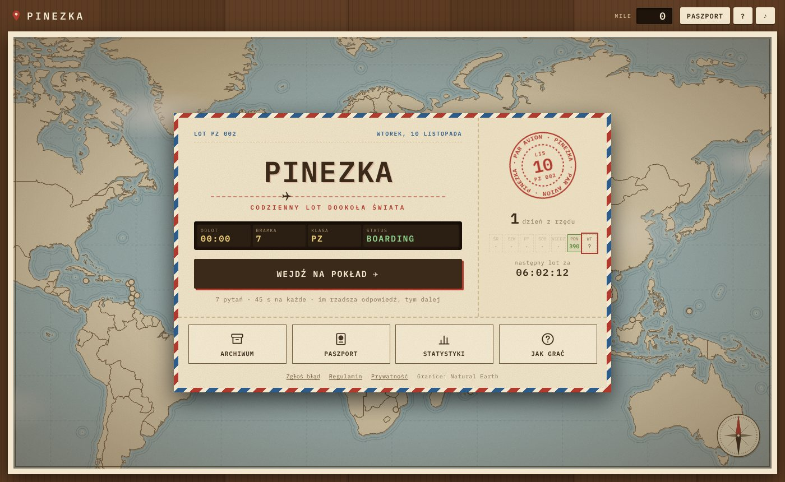
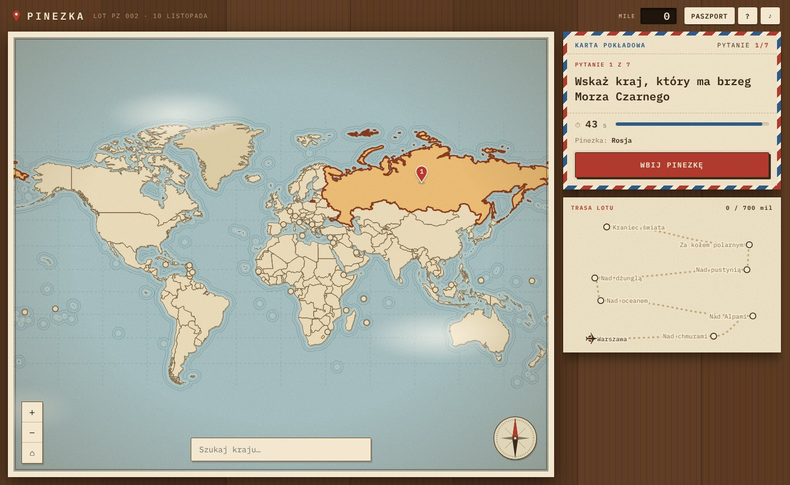
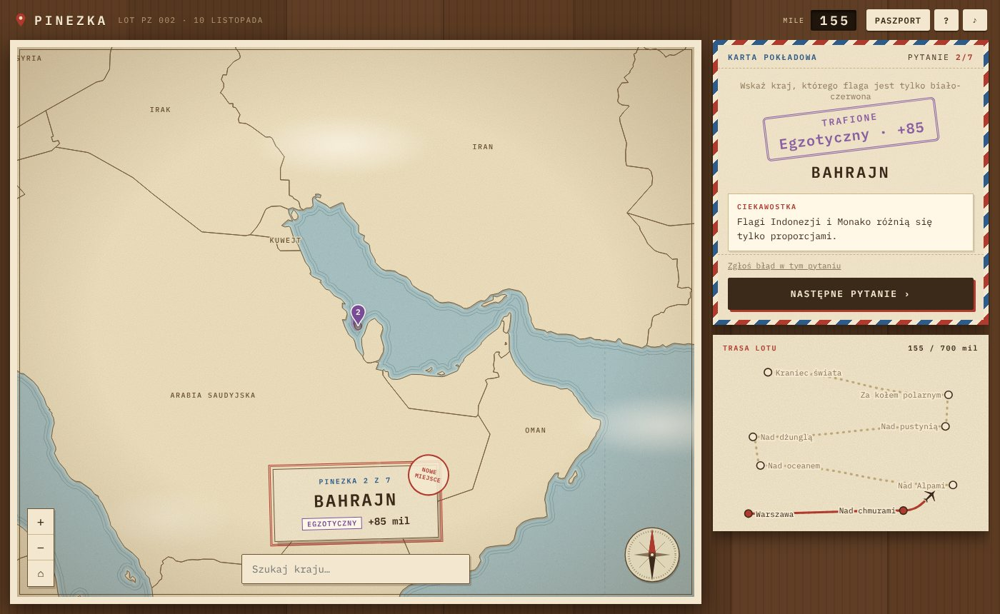
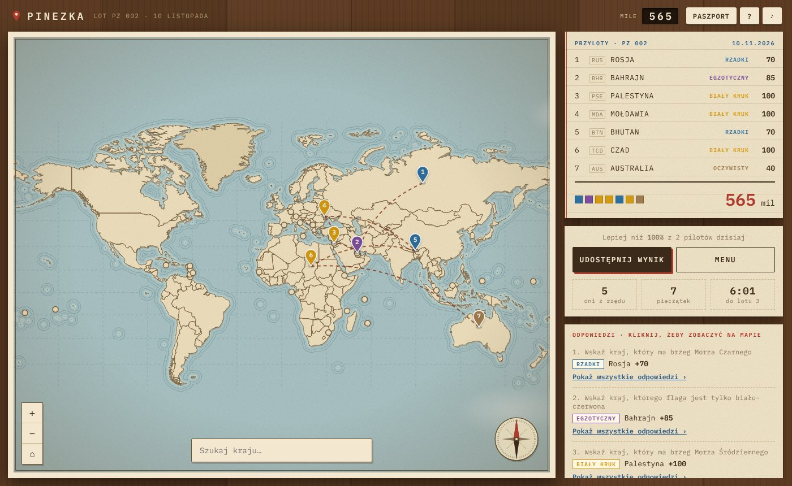
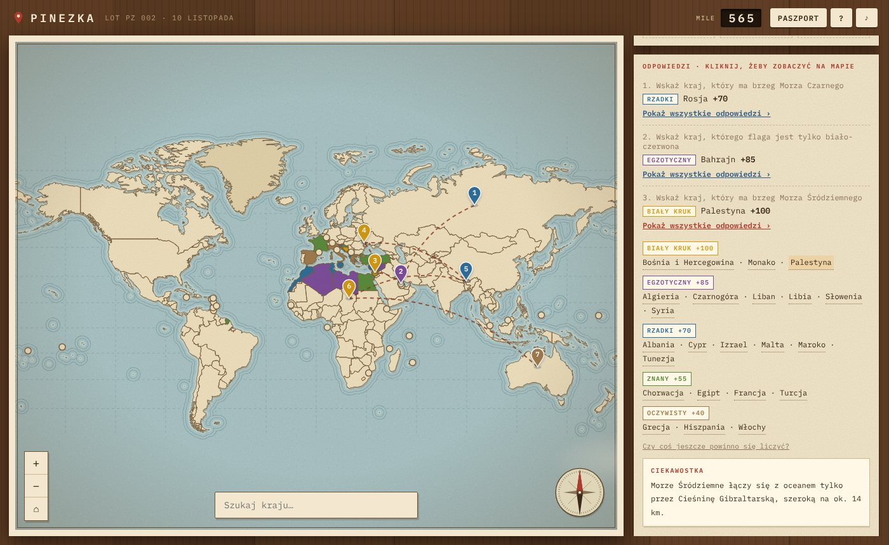
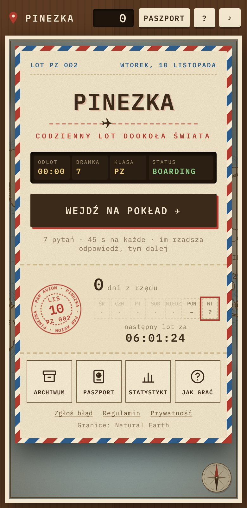
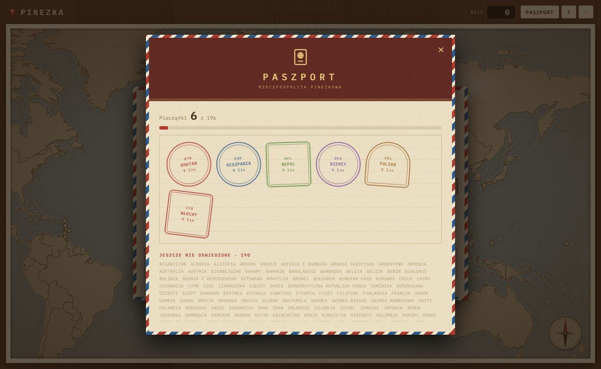

# 📍 Pinezka

**Codzienna gra geograficzna po polsku.** Każdego dnia 7 pytań, na każde 45 sekund. Wbijasz pinezkę w kraj na mapie. Im mniej oczywista trafna odpowiedź, tym dalej leci Twój samolot.

▶ **Zagraj: [pinezka.fun](https://pinezka.fun)**



| Pytanie | Wynik |
|---|---|
|  |  |

| Koniec lotu | Wszystkie odpowiedzi |
|---|---|
|  |  |

<p align="center"> &nbsp; </p>

## Jak się gra

- Pytania mają wiele poprawnych odpowiedzi, np. „Wskaż kraj, przez który płynie Dunaj”.
- Każda odpowiedź ma poziom rzadkości: **Oczywisty 40 · Znany 55 · Rzadki 70 · Egzotyczny 85 · Biały kruk 100** mil.
- Mile przesuwają samolot po trasie lotu, a nowe kraje dają pieczątki w paszporcie.
- Na koniec widać tablicę przylotów, wszystkie poprawne odpowiedzi na mapie i to, jak często wybierali je inni gracze.
- Archiwum poprzednich lotów, statystyki, seria dni, udostępnianie wyniku.

## Technicznie

- **Backend:** Node.js bez żadnych zależności (`http`, `fs`, `zlib`, `crypto`). Deterministyczny harmonogram pytań na każdy dzień (strefa Europe/Warsaw), anonimowe statystyki wyborów graczy w pliku JSON.
- **Mapa:** własny renderer na `<canvas>`: odwzorowanie Millera, granice z Natural Earth uproszczone do TopoJSON, obsługa antypołudnika, trafianie kraju przez `isPointInPath`, płynny zoom i przesuwanie (kółko, pinch, dwuklik), uproszczone rysowanie w trakcie ruchu.
- **Etykiety krajów** stoją w „biegunie niedostępności” każdego państwa, czyli punkcie najdalej od granic, liczonym transformatą odległości na siatce 0,25° (`tools/build-geo.js`).
- **Klimat:** papierowa mapa z falkami przy brzegach, motyw poczty lotniczej, animacje CSS/SVG (bilet, tablica odlotów z przeskakującymi literami, pieczątki), dźwięki generowane przez WebAudio.
- **Bez kont:** postęp w `localStorage`, bez ciasteczek i zewnętrznej analityki.
- **Panel autora** pod tajną ścieżką: zgłoszenia graczy, rozkład odpowiedzi na każde pytanie, dopisywanie brakujących krajów bez restartu.
- **Bezpieczeństwo:** limity zapytań na IP, jeden głos na pytanie, nagłówki CSP / X-Frame-Options / nosniff, porównanie klucza w stałym czasie, blokada po złych próbach logowania, ochrona przed path traversal.

## Uruchomienie

```bash
node server.js            # http://localhost:3000
```

Zmienne środowiskowe: `PORT`, `DATA_DIR` (domyślnie `./data`), `ADMIN_KEY` i `ADMIN_PATH` (panel autora), `CANONICAL_HOST` (przekierowanie na domenę główną).

```
server.js            serwer + API
shared/pytania.js    pytania (KOD kraju + poziom 1–5, ciekawostki)
public/              gra (gra.js, style.css, geo.json, kraje.js)
admin/               panel autora
tools/               generowanie mapy z danych Natural Earth
```

---

## 🇬🇧 English

**Pinezka** (Polish for *push pin*) is a daily geography game. Every day you get 7 questions with 45 seconds each, and you pin a matching country on the map. The less obvious your correct answer, the more miles your plane flies.

Built with dependency-free Node.js and a custom canvas map renderer: Miller projection, Natural Earth borders, labels placed at each country's pole of inaccessibility. It has a vintage air-mail look, an author panel and anti-abuse protections. Live at **[pinezka.fun](https://pinezka.fun)**.

---

Granice państw: [Natural Earth](https://www.naturalearthdata.com/) (domena publiczna). Czcionka: IBM Plex Mono (SIL OFL).
© 2026 [Mallinowo](https://github.com/Mallinowo). Wszelkie prawa zastrzeżone.
